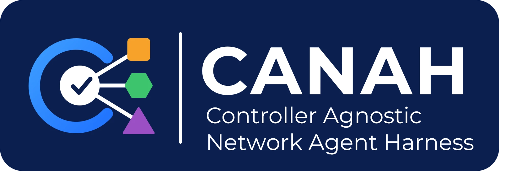

<p align="center"></p>

**CANAH** is an AI agent for running networks. It reaches every SDN controller through one
[agentic MCP](https://github.com/maconair0/agentic-mcp). It rehearses changes in a digital twin
([NetTwin](https://github.com/maconair0/NetTwin)) before the network sees them, and it changes nothing without a
person's approval.

## What it does

- **Every controller, the same way:** one tool per verb of a common contract (read devices, provision, …), with
  the controller as an argument.
- **Digital twin first:** what-ifs and writes are tried in NetTwin, or any twin that speaks
  [`canah.twin/1`](docs/TWIN_CONTRACT.md).
- **Approval and audit:** every change waits for an operator; every decision is logged.
- **Documents:** hybrid search with re-ranking on the GPU; answers cite their source, or say the documents do
  not cover it.
- **Web console:**
  - a topology of CANAH, its twin, the agentic MCP and the controllers;
  - a chat with live timings, diagrams and images;
  - controller onboarding and the common contract;
  - model and provider choice.
- **Any model:** Ollama locally, or Anthropic, OpenAI, Gemini, Groq, chosen on the Model page.

## Quick start

```bash
git clone https://github.com/maconair0/CANAH.git && cd CANAH
cp .env.example .env      # the agentic MCP's address and token, passwords (optional)
./start.sh                # installs on first run, then serves http://127.0.0.1:8350
./teardown.sh             # stops it
```

You need Python 3.10+ and [Ollama](https://ollama.com) with a model that can call tools
(`ollama pull qwen3:30b-a3b-instruct-2507-q4_K_M`). An NVIDIA GPU makes search and re-ranking faster, and
`start.sh` uses it when it finds one.

## Learn more

- [The full guide](docs/GUIDE.md): every page, setting and check, the retrieval pipeline, speed and the KV cache.
- [The digital-twin contract](docs/TWIN_CONTRACT.md), and [a custom twin in fifty lines](examples/custom_twin.py).
- Tests: `.venv/bin/python -m unittest discover -s tests_canah -t .`

## Authors and license

[maconair0](https://github.com/maconair0) (owner and author), with Claude (Anthropic) as co-contributor.
MIT: see [LICENSE](LICENSE).
