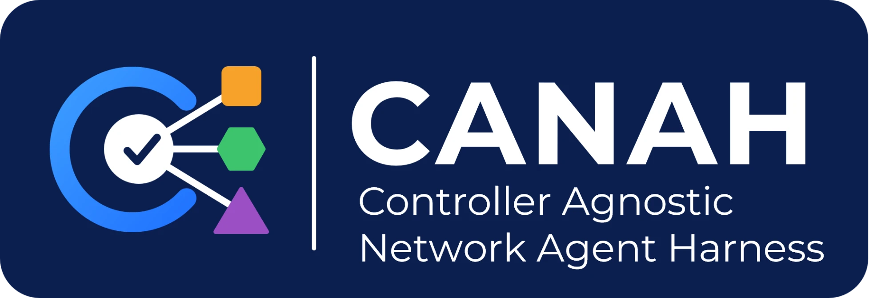

# CANAH: the full guide

Everything in detail: how it works, every setting and page, the measurements behind the claims. The short version is the [README](../README.md).

<p align="center"></p>

**CANAH (Controller Agnostic Network Agent Harness)** is a reusable central agent for networked systems, built on LangChain Deep Agents. It knows no particular network domain or controller: a system plugs in its controllers (through an [agentic MCP](https://github.com/maconair0/agentic-mcp)), its documents and any extra tools. The harness provides the rest:
- models, memory, skills and subagents;
- sign-in, with approval for every change, and an audit log of every decision;
- a sandbox to compute in;
- an HTTP service with a web console;
- checks that keep the agent to what its tools returned;
- digital twins behind one contract: a change is tried in a twin before it reaches the network.

## Start and stop

```bash
cp .env.example .env     # AGENTIC_MCP_URL / AGENTIC_MCP_TOKEN, CANAH_ADMIN_PASSWORD, CANAH_ROOT_PASSWORD (optional)
./start.sh               # the service and its web page on http://127.0.0.1:8350 (creates .venv on first start)
./start.sh --testbed     # with three emulated domains (packet, optical, fabric) to work against
./start.sh --status      # what is running
./teardown.sh            # stop it all; --purge also deletes the state in canah_data (asks first)
```

Open the printed address in a browser for the console (light and dark, in the style of edgeLM's central
console):
- **Sign-in page.** Sign in as admin or root, or continue as an observer (read only).
- **Topology.** CANAH, its digital twin (NetTwin), the agentic MCP it reaches the networks through, and every SDN
  controller the agentic MCP holds. The controllers are the agentic MCP's, not CANAH's. Click a controller to open its devices and links,
  read through the common contract's verbs. Click CANAH to open its agents (the librarian and a general-purpose
  agent), which light up while they work (`/activity`). The line from the agentic MCP to a controller lights up
  while CANAH works that controller.

  Arcs show relations across domains, and a controller that cannot be read is drawn red, with why. Zoom, pan,
  drag, fit, open or fold all; it refreshes live.
- **SDN controllers.** This page manages the agentic MCP and the controllers it holds.
  - **Connection:** the agentic MCP's address and token. The token is set here (root), kept readable only by
    CANAH's user and never shown again. CANAH reconnects at once.
  - **Common contract:** read the contract every controller is checked against. Edit it, preview every
    controller's verdict under the edit, and apply it (root). The agentic MCP keeps the previous version as a
    backup.
  - **Controllers:** each one's domain, contract verdict and gaps, and which of its own tools serve each contract
    verb.
  - **Adding controllers (admin):** onboard one by its URL. Or upload a list of controllers (JSON or YAML), a
    manifest for a new kind, or an API document or user guide to draft one from. Credentials are always the
    *names* of variables on the agentic MCP's host, never the secrets.
  - **Reload CANAH** gives every controller held now its agent. **Remove** (root) unseats one.
- **Chat**, in the style of LangGraph's agent chat UI, with the agent's call flow on the right (as edgeLM's console has it: who took each step, the tool, its arguments, what came back, how long it took; click any answer for its flow): thread history on the left; every tool call (subagents'
  included) as a card of its arguments with its result beneath; a change as an interrupt to **accept, edit** (the
  arguments as JSON) **or reject**, offered at the level it needs; a switch to hide tool calls. **Attach files**
  (button, drag and drop, or paste; up to 25 MB): kept per user, read by the agent as `/uploads/<thread>/<file>`,
  with PDFs read to text, and copied into the sandbox when there is one.
  - **One view:** drag the borders of the thread list and of the call flow to resize them (double-click resets);
    nothing scrolls sideways.
  - **While it works:** a live status says what CANAH is doing ("Searching the documents", "Read devices on onos,
    through the agentic MCP"), each tool card counts its time, and the answer ends with its total time, time to
    first words and tool calls. You can scroll up while it writes; **Jump to latest** brings you back.
  - **Code and pictures:** every code block has **Copy**. A ```` ```mermaid ```` block is drawn as a diagram, with
    SVG and PNG downloads. CANAH draws pictures itself with `draw_diagram`; they appear in the answer, and
    **Images** in the header opens every picture of the conversation. **Suggest a change** on any picture asks
    CANAH to redraw it: it reads the diagram back (`get_diagram`), edits it and draws it again.
- **Model & providers** (root to change). Pick any chat model Ollama has on this machine, and its context window,
  or a hosted provider (Anthropic, OpenAI, an OpenAI-compatible server, Gemini, Groq) with its API key. A new
  model is tried with one short question first, and CANAH switches only if it answers. Keys are kept readable by
  CANAH's user only and never shown again. `CANAH_MODEL` in the environment still wins.
- **Approvals & audit.** What waits in your conversations; the audit log and 24-hour metrics (admin).
- **Documents & memory.** The **second brain**: the documents the agent cites as a graph (a node per document,
  edges by meaning, named clusters), as in edgeLM; the corpus with upload (admin); long-term memories (admin).
- **Profile & access.** What each level may do. **About & shortcuts.** Keys: `g` then `t c h a k`, `[` `]`, `/`, `n`.

**`start.sh`**
- creates `.venv` and installs `requirements.txt` on first use;
- reads `.env`; a variable already set in the shell wins;
- checks the model answers (and is pulled, for Ollama; has its key, for a hosted one);
- checks Docker and builds the sandbox image if it's missing;
- starts the service in the background and waits until it answers.

It won't start a second copy. Options: `--port`, `--host`, `--tls-cert/--tls-key`, `--no-sandbox`, `--foreground`, `--testbed-port`.

**`teardown.sh`** stops what `start.sh` started, through pid files: SIGTERM first, SIGKILL only after 20 s. It also removes sandbox containers whose agent has stopped.

Logs are in `canah_data/logs`, pid files in `canah_data/run`.

**From the terminal:**

```bash
.venv/bin/python -m canah chat                  # sign in as admin or root, or continue as observer
.venv/bin/python -m canah ask "which routers are down?" --as observer
.venv/bin/python -m canah info                  # what the agent was built from
.venv/bin/python -m canah user add NAME --level admin|root    # accounts; also: user list, user remove NAME
.venv/bin/python -m canah audit [N]             # the last N decisions and changes
.venv/bin/python -m canah metrics [HOURS]       # requests, times, tokens, tool calls, checks that sent answers back
.venv/bin/python -m canah memories [USER]       # long-term memories; memories forget USER PATH
.venv/bin/python -m canah docs add FILE...      # add documents to the corpus and index them
```

To try it without any network, use the demo system: `CANAH_PROVIDERS=examples.demo_network:provider ./start.sh`.

## The model

[canah/models.py](../canah/models.py) has one section per provider. Exactly one is active (local Ollama, by default) and the rest are commented out: comment out the active one and uncomment the one you want. The sections cover Anthropic, OpenAI, other Ollama models, OpenAI-compatible servers (vLLM, LM Studio, OpenRouter), Gemini, Bedrock and Groq.

There are three roles: `model` (the main agent), `strong_model` (for a subagent that asks for it) and `fast_model`. An optional `fallback_model` takes over if the main one fails. `CANAH_MODEL=provider:model` in the environment overrides the active section without editing the file. Every line caps the reply length and sets a timeout.

## What's in it

| File | What it does |
|---|---|
| `canah/models.py` | which model; one place |
| `canah/config.py` | settings: `canah.yaml`, then the environment (see Settings below) |
| `canah/agent.py` | `build_agent()`: the pieces into `create_deep_agent`; `CanahAgent.ask / stream / pending / decide`. Takes `middleware` and `interrupt_on` directly too |
| `canah/tools.py` | the `ToolProvider` contract: `tools()`, `writes()`, and optionally `subagents()`, `main_tools()`, `shared_tools()`, `middleware()`, `instructions()` |
| `canah/network.py` | networks through an agentic MCP service: `network_controllers` and `network_health` on the main agent; one `net_<verb>` tool per verb of the common contract that any controller serves (the controller is an argument; a read without one asks every controller), `network_tools` to find a controller's own tools beyond the contract and `controller_read` / `controller_write` to call them. No agent per controller: the contract makes every controller's verbs the same; `follow_relations`, which follows dependency chains across domains in code, for any controller that publishes `list_relations` |
| `canah/knowledge/` | documents: a quick cited search (any subagent may use it), a `librarian` subagent, passages marked with the question's names they don't mention, a citation check; production retrieval in `rag/` (see [Retrieval](#retrieval)) |
| `canah/identity.py` | observer / admin / root: accounts (environment, or `users.json` with PBKDF2 hashes), sign-in with lockout; the model is offered only the tools the caller may use |
| `canah/approval.py` | every write pauses for a decision: approve, edit or reject |
| `canah/memory.py` | per-thread state (SQLite checkpointer); long-term `/memories/` per user (SQLite store), with listing, deletion and optional expiry |
| `canah/backends.py` | the files the agent sees: scratch, `/memories/`, skills and `AGENTS.md` read-only, kept large results |
| `canah/sandbox/` | where `execute` runs: a locked-down Docker container started with the agent |
| `canah/grounding.py` | checks on the agent's answers (see below) |
| `canah/safety.py` | per request: token counting and budget, screening tool output, recording and re-reading changes, guarding memory writes |
| `canah/large_results.py` | a large tool result is kept whole; the model gets a preview, the path, and a summary of its label fields |
| `canah/ops.py` | the audit log and request metrics (`canah_data/ops.sqlite`) |
| `canah/service.py`, `canah/static/` | the HTTP API and the web console (`index.html`, `app.js`, `app.css`, logos, fonts) |
| `canah/topology.py` | each controller's devices and links, read through the contract's verbs, for the console |
| `canah/subagents.py` | subagents from code or YAML; tools by name or pattern |
| `canah/mcp.py` | minor extra tools over MCP (`mcp.json`): read-only unless allowed, and writes then need approval |
| `canah/skills/` | `approvals`, `incident-triage`, `research` (SKILL.md, loaded on demand) |
| `canah/context/AGENTS.md` | standing instructions loaded at every start |
| `canah/cli.py` | the terminal commands above |
| `testbed/` | three emulated domains behind an agentic-MCP-compatible service, checked cases, and a runner (see Testing) |
| `examples/demo_network.py` | a tiny pretend network, to try the agent with nothing else running |

**To serve a system:**
1. Point the agentic MCP at its controllers (or write a `ToolProvider`, and list it under `providers:` in `canah.yaml`).
2. Add its skills and an `AGENTS.md`.
3. Index its documents.

The harness imports nothing system-specific.

## Retrieval

The agent's document answers come from `canah/knowledge/rag`, and each stage is there for accuracy:

1. **Hybrid candidates.** Dense search (Chroma, `mxbai-embed-large`) and BM25 each return 20, merged by reciprocal rank fusion. Exact identifiers (RFC numbers, model names) come in through BM25, paraphrases through dense search.
2. **Filter.** Inadmissible chunks are dropped: front matter, reference lists, fragments. A length prior damps passages too short to answer anything.
3. **Re-rank.** A cross-encoder (`cross-encoder/ms-marco-MiniLM-L-6-v2`) reads the question and each of the 24 best candidates together. If it cannot load, the local LLM re-ranks instead.
4. **Parents.** Small child chunks are ranked, and their parent passages are what the agent reads. Duplicate parents are dropped before the cut to `k`, so `k` results are `k` different passages.
5. **Relevance gate.** The re-ranker's score becomes a relevance from 0 to 1. A passage below `RAG_MIN_RELEVANCE` (0.1) is not evidence.
6. **Corrective retrieval.** When nothing passes, the local LLM rewrites the question three ways (key terms, a paraphrase, a hypothetical answer). The search runs again, but the results are still judged against the original question.
7. **Abstention.** When still nothing passes, the tool answers `NOT IN THE DOCUMENTS`. It lists the nearest sources, judged not to answer, and the agent is told to say the documents do not cover the question.

Every passage the agent sees shows its relevance and its citation, and a citation check runs on the agent's reply.

**Measured, not assumed.** Running `python -m canah.knowledge.rag.evaluate build` writes a golden set to `<CANAH_HOME>/knowledge/eval/golden.json`. It holds one question per sampled passage, written by the local model, plus questions the corpus does not answer, some of them from the same field. `run --compare` scores the pipeline with and without its gate. The current corpus gives these results (40 answerable questions, 14 not answerable):

| | hit@1 | hit@5 | MRR | declines unanswerable | declines answerable | p50 |
|---|---|---|---|---|---|---|
| without the gate | 0.75 | 0.90 | 0.82 | 0 of 14 | 0 | 0.27 s |
| production | 0.75 | 0.875 | 0.81 | **14 of 14** | **0** | 0.27 s on the CPU, 0.04 s on the GPU |

Without the gate, every unanswerable question came back with five confident-looking passages. The production pipeline declines all 14 and declines no answerable question. `BAAI/bge-reranker-base` ranked no better, ran 3.5× slower, and its scores could not separate the two kinds of question, so MiniLM is the default (`RERANK_MODEL` overrides it). If the corpus or the model changes, re-run the eval and choose `RAG_MIN_RELEVANCE` from its `best_relevance` lists.

## Speed

CANAH is built to answer quickly. Measured on an RTX A5000 with qwen3 30B in Ollama:

| | Time |
|---|---|
| a document search, from question to re-ranked passages | about 45 ms (was 130 ms) |
| first event of a reply on the page | 0.5–0.7 s, including the first question after a start |
| "hello" | 0.6 s |
| `./start.sh` to a running service | about 5 s |

What makes it fast:
- **On the GPU.** The re-ranker and the embedder run in half precision, in the service's own process:
  - re-ranking 24 passages takes 22 ms, against 128 ms on the CPU;
  - embedding a question takes 19 ms, against 75 ms through Ollama. The vectors match an index built by Ollama (cosine 0.9999).
- **Device settings.** `start.sh` installs the CUDA build of torch when it finds an NVIDIA GPU (`CANAH_NO_GPU=1` skips that). `RERANK_DEVICE` (`auto`, `cuda`, `cpu`) and `EMBED_BACKEND` (`auto`, `local`, `ollama`) choose where each part runs.
- **Sharing the GPU with Ollama.** When the GPU is full, the re-ranker moves to the CPU and the embedder falls back to Ollama, rather than failing.
- **Warm at start.** In the background, the service opens the index, loads both models and runs one hidden turn. That loads the chat model and puts the agent's ~7,000-token system prompt in Ollama's prompt cache, so the first question doesn't wait for any of it (`CANAH_WARM=0` turns this off).
- **Streamed.** Tokens and tool calls reach the page as they happen. The page and its scripts are gzip-compressed (`app.js` from 95 KB to 28 KB).
- **No answer written twice.** When the look-first check asks whether an answer needed a lookup, the model can reply with the single word `KEEP` rather than writing the whole answer out again. That made "what can you do?" 2.5 s instead of 6.1 s.
- **Little repeated work.** The model stays loaded for 24 hours (`keep_alive` in `canah/models.py`), and Ollama still unloads it when another model needs the memory. Question embeddings are cached. The corrective pass embeds and searches its rewrites in one batch.

## Context window and KV cache

Every reply reports two figures, shown under the chat box and totalled on the Operations page:

- **Context:** how much of the model's input window the conversation now fills. It shows as a bar with a mark at the compaction point.
- **KV cache:** how much of this turn's prompts the model reused rather than read again.

**Context window.** The window comes from the model's LangChain profile (`max_input_tokens`).
- **Ollama:** `ChatOllama` has no profile, so CANAH sets one from the model itself: `num_ctx` less `num_predict`, which is 28,672 tokens for the default model. Without that, deepagents would compact only at 170,000 tokens, which a 32k Ollama window never reaches. Ollama would then silently drop the start of the prompt, system prompt first.
- **Automatic compaction:** deepagents' summarization compacts at `compact_at` of the window (default 0.85). The older part of the conversation is summarised, and the most recent `compact_keep` (default 0.10) is kept word for word. What was summarised is saved under `/conversation_history/`, where the agent can read it back. The trigger is the token count the model itself reports, so it is exact.
- **Compacting on request:** the agent has `compact_conversation` (deepagents' `SummarizationToolMiddleware`). Asking it to compact, or typing `/compact`, compacts sooner, once the conversation is at half the compaction point.
- **Settings:** `context_window` overrides the window; `compact_at`, `compact_keep` and `compact_tool` set the rest (`CANAH_CONTEXT_WINDOW`, `CANAH_COMPACT_AT`, `CANAH_COMPACT_KEEP`).
- **Measured:** with a 9,000-token window, the third long message pushed the conversation past 85%. The next turn compacted it from 104.6% down to 86.9%.

**KV cache.** A model keeps the keys and values it computed for a prompt. A next prompt that begins the same way reuses them and reads only what is new. CANAH keeps its prompts append-only so that each turn begins exactly as the last one did:
- the system prompt and tool list stay fixed for the whole session;
- every check adds its message at the end, never in the middle;
- the warm-up at start puts the system prompt in the cache before the first question.

How the cache is measured depends on the model:
- **Hosted models:** LangChain reports the cache exactly (`usage_metadata.input_token_details.cache_read` and `cache_creation`). deepagents adds the prompt-caching middleware for Anthropic, Bedrock and Fireworks itself.
- **Ollama:** it reuses the longest common prefix with the last prompt in a slot, but reports only the prompt's length and how long reading it took. CANAH estimates the cached share from that time against the cold reading speed measured in the same process, and marks it as an estimate (≈).
- **Measured:** about 96% of prompt tokens come from cache on every turn after the first. A cached 7,200-token prompt is read in 0.04–0.13 s, against 2.4 s cold.

**One Ollama slot.** Ollama keeps one cache per parallel slot, and the default is one. Any other request to the same model (a subagent with its own system prompt, another application) replaces CANAH's cached prompt, and the next turn reads it all again. More slots fit in the same GPU memory when the KV cache is stored in 8-bit:

```bash
sudo systemctl edit ollama      # then add:
# [Service]
# Environment="OLLAMA_FLASH_ATTENTION=1" "OLLAMA_KV_CACHE_TYPE=q8_0" "OLLAMA_NUM_PARALLEL=2"
sudo systemctl restart ollama
```

For qwen3 30B-A3B at 32k tokens, one slot at 16-bit takes about 3.2 GB, and two slots at 8-bit take the same. Ollama sends each request to the slot whose cache matches it best.

## The team of agents

With `team: true` (the default), CANAH works as a supervisor with agents of its own. They are all built from the
same tools; what differs is who holds which.

| Agent | Holds | Does |
|---|---|---|
| **CANAH (supervisor)** | every read (`net_read_*`, `network_tools`, `controller_read`), knowledge, operations | answers, plans, delegates; changes nothing itself |
| **qot** (quality of transmission) | every read, the digital twin (`twin_validate`, `twin_predict`, `twin_check_write`, `twin_extra`), incidents, history, health over time | watches quality and health, rehearses what-ifs and changes in the twin, ends with a `PROPOSAL` and the `TWIN` verdict |
| **<domain>-config** (one per network domain: `packet-config`, `optical-config`, `data-centre-config` …) | the same tools, cut to that domain's controllers, writes included (`net_provision`, `net_adjust`, `controller_write` …) | makes exactly the change it was given, which waits for approval, then reads it back |
| librarian, general-purpose | documents; the supervisor's tools | as before |

A change goes from the supervisor straight to the domain's config agent. Its write is rehearsed in the twin by the
write gate before it is sent, then waits for approval, so nothing has to rehearse it twice. `qot` takes the what-ifs,
"is it safe", quality questions, and incident fixes. A plain change ("create LP-3 …") handed to `qot` is turned back
to the config agent (`DelegationGuard`). Config agents hold no twin tools of their own: the gate checks their writes,
and an override (`twin_override`) is the operator's, through the supervisor, for a check the gate really held. The
approval, the twin's write gate and the scopes apply in every agent, because they are middleware on every
agent.

Every read verb (and `controller_read`) takes `match`, comma-separated words such as `'xpdr-b2, xpdr-c2'`. The
harness, not the controller, cuts every list in the answer to the items that mention them. A 13-node optical inventory
with 24 ports each becomes the two transponders asked about. It works the same on every controller. The domains come from what each controller declares to the agentic MCP, so a new domain gets its config
agent at the next reload. `team: false` goes back to one agent doing it all.

## Operations: incidents, runbooks, history, notifications, scopes

The watcher works on two clocks. **Every 5 s** (`heartbeat_s`) a heartbeat calls each controller's health check
(the contract's health verb, a light call that reads no devices) in parallel, then reads the agentic MCP's view of
each session; a controller going down or coming back, or the agentic MCP itself not answering, starts a full read
at once. **Every 30 s** (`watch_interval_s`) a full read takes each controller's devices, links, services and
alarms. A controller that stops answering is an incident within seconds (3.5 s on the test bed), without reading
every device every few seconds. `heartbeat_s: 0` turns the heartbeat off.

Everything here runs on the common contract's verbs and the normalised topology, so any controller the agentic
MCP accepts is covered with no new code.

- **The watcher** (`canah/incidents.py`) reads every controller each minute (`watch_interval_s`). It sees:
  - the agentic MCP or a controller not answering (its sessions, and failed reads);
  - a device or link down, from the topology;
  - a service whose status reads as down (`read_services`);
  - an alarm (`read_alarms`), at the severity the controller gave it.

  Each finding becomes an **incident**, deduplicated, and resolved by itself after `resolve_after` reads without it.
- **Runbooks** (`canah/runbooks/*.yaml`, and yours in `<CANAH_HOME>/runbooks`) match an incident by kind, severity,
  controller or text:
  - `notify` only sends the incident;
  - `investigate` has CANAH look into it in a thread of its own (`canah-watch.incident-<id>`) and write a report;
  - `propose` also hands the fix to the domain's config agent. The write gate rehearses it in the twin, and the fix
    waits for approval. Low trust in the twin (`gather_more_data`, tier C) is reported with the proposal; only a
    twin `reject` holds it back.

  A fix always waits for a person: approve or reject it on the incident. At most `respond_per_hour`
  investigations start on their own; `respond: false` stops them.
- **Notifications** (`canah/notify.py`, `notify_channels`): webhook, Slack, Teams or email. Each channel has a
  minimum severity and the events it takes: an incident opened or resolved, a change waiting for approval. A
  secret is always the name of an environment variable.
- **The networks' history** (`canah/history.py`) keeps each controller's devices, links and services whenever
  they change. The Incidents page's **Network changes** tab, and the agent's `network_changes`, answer "what
  changed, and when".
- **Health over time** (`canah/health.py`): at every reading, each controller's devices, links and services (how
  many, how many down) and its open incidents, kept for 30 days. They are charted on the Incidents page, and the
  agent reads them with `health_over_time`.
- **Scopes:** root can limit an account to some controllers (Profile & access). Its tools, topology, incidents
  and approvals then keep to them.
- **Self-knowledge:** `canah_status` gives the agent who is asking and what they may do, the controllers in reach,
  what the harness already has, what it does not have yet, and what needs attention.
- **Undo:** on an executed change in the audit log, **Propose undo** asks CANAH for the inverse change, rehearsed
  and approved like any other.
- **Skills:** `intent-to-change` ("10 Gbit/s from A to B" to a checked change), `service-scaling` and
  `incident-triage`.

## Who may do what

| Signed in as | Sees write tools | May approve |
|---|---|---|
| observer (no password) | no | nothing; may only reject |
| admin | yes | every write, and every paused tool, except `root_tools` |
| root | yes | everything |

**Approvals:**
- A write through the agentic MCP is gated twice: here, by the approval; and there, by its own write gate, which accepts a call only with the approver's name. That name is sent only after an approval here.
- A change waiting longer than `approval_ttl_s` (default 1 h) can only be rejected.
- `notify_url` gets a JSON message whenever a change starts waiting.
- Every change proposed, every decision (who, level, approve/edit/reject, message) and every result is in the audit log.

## Checks on what the agent says

Each check sends an answer back once, with the reason, for the model to correct itself:

| Check | What it catches |
|---|---|
| grounding | values, counts and names in an answer (decimals, long numbers, ids, labelled or quoted values) that no tool returned and the operator didn't say |
| citation | a `[source p.N]` citation of a source no tool returned |
| follow-through | an answer that announces its next step, says it lacks data its tools can get, or (for someone who may approve) asks "shall I proceed?" in text instead of making the change for approval |
| look first | a substantial answer given without looking anything up (not an observer's change, whose answer is that an admin must ask) |
| documents | a question that points at the documents ("use the design rules") answered without searching them |
| delegation | a what-if answered without `qot`; a plain change handed to `qot`; an admin's change ending in a plan or "shall I?" with nothing handed to a config agent; an observer's change sent to a config agent |
| make the change | (config agents) a task report with no write tried, or without a write tool the task named |
| scope | (before approval) a delete, teardown or disconnect the operator did not ask for: taken back, and the model asked again without it ("xpdr-a1 already carries LP-1" is the answer, not deleting LP-1) |
| arithmetic | a wrong comparison of numbers: "1200 falls within 100 to 999" (or "within this range", the range stated just before), "21.4 is below 15" |
| relations | a question about what carries what (a path, an impact, what is at risk) answered without `follow_relations` |
| twin report | an answer that drops the decision in `qot`'s TWIN line, or says the twin could not answer when its report has a prediction |

The checks share one notion of "this turn": every check's own messages are skipped, so one check's send-back is
never taken by another for a new question with nothing read yet.

Every tool call, by the supervisor or inside a subagent's task, is one line in `CANAH_HOME/calls.log` (who, the
arguments, the start of the result, how long it took). What a subagent did is otherwise invisible: only its
report comes back.

A write refused because the object is not on that controller says where it is, and which config agent changes it
there ("border-leaf-1 is not on packet: it is on fabric, changed by data-centre-config").

A large result is kept under a short name (`/workspace/.results/r3-net_read_statistics.json`) with its structure and
a `jq` command for it, so the model filters it rather than paging through it or guessing at its shape.

Documents: Markdown is cut at its headings, each passage led by its heading path ("Design rules > Packet domain"),
so one passage holds one subject. The 250-character floor that drops headings and captions applies to PDFs; a short
section of a text file is content. A search that finds nothing tries the operator's question, then each question in
it on its own. After upgrading, re-index Markdown with `python -m canah.knowledge.rag.refresh --force`.

Writes are reported by the harness, not only by the agent: a delegated task's result ends with every write sent in
it, exactly as sent, and what each returned, so the supervisor compares what was done with what it asked for.

A knowledge search that finds nothing for the model's keywords tries the operator's own question once before it
says the documents do not cover it. A cross-encoder trained on questions scores keyword strings near zero.

In every subagent too:
- **Screening:** text from a tool that reads like instructions to the model is fenced as data.
- **Read-back:** after an approved change, the agent is told to read the object back before reporting success.
- **Budgets:** each request has a time budget (`max_seconds`) and an optional token budget, across the main agent and all subagents.
  One delegated task gets a share of it (`task_seconds`, by default a third of what is left). A subagent that goes in
  circles ends with what it had, and the supervisor still has time to act or say so.

## Self-correction: checked changes and lessons

Two parts, both done by the harness rather than by asking the model to judge itself (the same model shares its
own blind spots; the checks above are code for the same reason).

**Every change is read back against what was asked.** After a write goes through, the harness reads that
controller's devices, links and services through the contract's reads. It finds the object the write names (for
`connect_tenant_external(tenant, service)` the tenant, the named value that is an object there), and checks:

- it is listed (or, for a removal, gone);
- it is not down;
- it shows the values the write gave it (numbers compared as numbers, names as whole words).

The result is on the write's answer: `[Verified by the harness: packet now lists VS-300 (vlan 300, over L-ab …)]`, or
`[Not as intended: … it does not show over=L-ab]`. A failure is also in the audit log ("not as intended") and is
reported, with the correction or a rollback proposed for approval, never as done. It works on any controller that
serves the read verbs, and says "not verified" when there is nothing to read back from. Incident investigations
also see every change made in the last 30 minutes, since a fault that follows a change may be its result.
`verify_changes: false` turns the read-back off.

**Lessons keep a correction past its conversation.** The harness keeps a short lesson when:

| kind | when |
|---|---|
| refused-then-done | a controller refused a write, and it went through after another step or with other values |
| not-as-intended | the read-back did not show what was asked |
| twin-rejected | the digital twin rejected a change |
| operator-rejected | an operator rejected a change and said why |

At each request the lessons that fit it (by the controllers and tools it names and the words they share; three
at most) are put in front of the supervisor and the config agents, marked as the harness's and possibly out of
date. A lesson seen again is counted, not repeated. They are memories of the reserved user `~lessons`: the
Documents & memory page lists them ("Lessons · kept by the harness"), and an admin can correct or forget one. They
expire after `lessons_ttl_days` (30) unless seen again. `lessons: false` turns them off.

The test bed has a controller that answers every write as done and applies none (`writes_ignored`); the case
`packet-silent` checks that CANAH says the change is not there instead of reporting it done.

## Digital twins

A digital twin predicts what a change or a failure will do to a network before the network sees it. CANAH can use **any** twin that speaks one contract, `canah.twin/1` ([docs/TWIN_CONTRACT.md](TWIN_CONTRACT.md)): four calls (describe, validate, predict, and optionally check a controller write), in-process or over HTTP, with one standard shape for the answer.
- **The answer:**
  - a decision: propose, reject, gather more data, met, not met;
  - the probability that the requirements hold, and its interval;
  - a trust tier;
  - the figures with and without the change;
  - exactly what change ran, and what the twin does not model.
- **One set of tools for the agent,** whichever twin is in use: `twin_list`, `twin_schema`, `twin_validate`, `twin_predict`, `twin_check_write`, `twin_override`, `twin_extra`.
- **A gate on controller writes:** when the twin in use can check writes, a write goes ahead only if the twin supports it or an operator overrides its check, with their reason; the override is itself approved and audited.
- **Chosen on the web page:** **Digital twins** lists the twins, tests them, adds a custom one (an HTTP URL, or a Python `module:factory`) and switches the one in use, with no restart.

**NetTwin is CANAH's digital-twin environment by default.** [NetTwin](https://github.com/maconair0/NetTwin) (the
`netwins` package) has four twins behind this contract:
- **IP / packet:** ns-3;
- **Optical (WDM):** GNPy, calibrated against the lab's physical layer;
- **Wi-Fi:** ns-3;
- **Non-terrestrial (satellite and HAPS):** orbits, rain fade and adaptive coding.

CANAH turns to it when a question or a change calls for it:
- a what-if ("if this link fails…", "if it rains on the terminal…") is rehearsed there and answered with its
  decision, probability and trust tier;
- before a write reaches a controller, the gate checks it in NetTwin first;
- NetTwin mirrors the live packet networks through the agentic MCP, so its picture of them is current.

The topology draws NetTwin beside CANAH (the dashed teal line), lit while CANAH is asking it. The chat says when a
change is being rehearsed in NetTwin. Any other twin that speaks the contract can replace it.

```yaml
# canah.yaml
twins:
  - {name: netwins, kind: python, spec: netwins.contract:twin, path: ~/netwins}   # https://github.com/maconair0/NetTwin
  # - {name: lab-twin, kind: http, url: "http://10.0.0.9:8420", token_env: LAB_TWIN_TOKEN}
twin_active: netwins
twin_gate: true
```

[`examples/custom_twin.py`](../examples/custom_twin.py) is a complete custom twin in about fifty lines of model, with only the standard library. Start from it to plug in your own.

## The sandbox

A Docker container starts with the agent, so `execute` is there from the first message. It's removed when the agent exits; files in `/workspace` are kept in a volume.

The container:
- has no network;
- has a read-only root filesystem and runs as uid 1000;
- drops all capabilities;
- has limits on processes, memory and CPU;
- uses gVisor if Docker has it.

Each container is labelled with the process that owns it, and one left behind by a process that's no longer running is removed at the next start. If Docker isn't usable, the agent starts without the sandbox and says why. `--no-sandbox`, or `sandbox: none`, turns it off on purpose.

## The HTTP API

| Endpoint | What it does |
|---|---|
| `POST /session`, `GET /session`, `DELETE /session` | sign in (a bearer token), who am I, sign out; sessions are kept across restarts |
| `POST /threads` | a new thread |
| `POST /threads/{id}/messages` | a message; returns the reply, what's pending, the tool calls |
| `POST /threads/{id}/stream` | the same as server-sent events: token, tool_call, tool_result, reply |
| `GET /threads/{id}/pending` | what the thread waits on, and whether you may approve it |
| `POST /threads/{id}/decide` | approve / edit / reject (also streamed) |
| `GET /audit`, `GET /metrics` | the audit log; request metrics (admin) |
| `GET /memories`, `DELETE /memories/{user}?path=` | long-term memories (admin) |
| `GET /documents`, `POST /documents` | the corpus; add a document (admin) |
| `GET /threads/{id}/history` | the conversation so far, for reloading it |
| `GET /network`, `GET /topology[?refresh=1]` | the controllers and their health; their devices, links and cross-domain relations |
| `POST /threads/{id}/files` | attach a file to a conversation (`{"name", "content_base64"}`) |
| `GET /activity`, `GET /knowledge/mesh` | what runs now and which subagents are at work; the documents as a graph |
| `GET /network/kinds`, `POST /network/controllers`, `DELETE /network/controllers/{key}` | onboard (admin) or remove (root) a controller through the agentic MCP |
| `POST /network/manifests`, `POST /network/guides`, `POST /admin/reload` | add a controller kind (admin); rebuild the agent so new controllers get subagents (admin) |
| `GET /info`, `GET /health`, `GET /` | what the agent is built from; liveness; the web console |

No token means an observer. Threads belong to the user who made them, and a busy thread gets 409. Use `--tls-cert/--tls-key` when serving beyond localhost.

LangSmith tracing needs no code: set `LANGSMITH_TRACING=true` and `LANGSMITH_API_KEY`.

## Settings

These go in `canah.yaml`, or in the environment as `CANAH_<NAME>` for the common ones.

| Setting | Default | What it does |
|---|---|---|
| `providers` | network, knowledge | the systems served, as `package.module:factory` |
| `sandbox` | `docker` | `docker` or `none` |
| `root_tools` | delete, remove, reboot, restart | writes only root may approve (glob patterns) |
| `interrupt_on` | none | more tool calls that pause for approval: `{pattern: true \| {allowed_decisions, description}}` |
| `middleware` | none | extra LangChain middleware for every agent, as `package.module:Class` |
| `max_seconds` | 600 | time budget per request |
| `watch_interval_s`, `heartbeat_s` | 30, 5 | the watcher's full read, and its heartbeat |
| `investigate_workers` | 2 | investigations of unrelated events run side by side |
| `verify_changes` | on | read every change back and say whether it is what was asked |
| `lessons`, `lessons_ttl_days` | on, 30 | keep what went wrong; show the fitting lessons at the next request |
| `task_seconds` | 0 (a third of what is left) | one delegated task's share of it |
| `max_tokens_per_request` | 0 (none) | token budget per request |
| `approval_ttl_s` | 3600 | how long an approval stays open |
| `notify_url` | none | webhook for changes waiting |
| `memory_ttl_days` | 0 (kept) | expiry of long-term memories |
| `knowledge_collection` | `corpus` | which document collection to search |
| `large_result_chars` | 12000 | above this, a tool result is kept whole and previewed |
| `look_first`, `audit` | on | the look-first check; the audit log and metrics |
| `skills_dirs`, `memory_files`, `subagents_file`, `mcp_config` | the harness's | skills, `AGENTS.md` files, subagents YAML, minor MCP tools |

## Testing

```bash
.venv/bin/python -m unittest discover -s tests_canah -t .   # 117 tests: scripted model, fake services, about 30 s
.venv/bin/python -m testbed.run --rounds 2                   # live: the real model on the emulated domains
.venv/bin/python -m tests_canah.browser_check                # the web page in headless Chromium (needs playwright)
```

**`testbed/`** emulates three network domains, each a controller with its own state and tools:
- **packet:** routers, links, VLAN services;
- **optical:** ROADMs, transponders, lightpaths with OSNR;
- **fabric:** a data-centre leaf-spine with tenants.

They meet at declared hand-offs: a packet link rides an optical lightpath, and a tenant leaves through a border leaf to a packet service. All three sit behind an agentic-MCP-compatible service with its write gate. The runner asks 18 checked questions:
- **per domain:** read, a large read, a change with approval, an observer refusal, live state combined with the design rules;
- **across domains:** chains, impact of a fault, a tenant's path out, a build under a cross-domain rule, an observer refusal.

Each case is checked against the answer and against the domain's state afterwards. Results go to `testbed/results/`, with a score per domain, the model and the harness commit. The domain-specific material (the emulator, its `AGENTS.md`, skills and design rules) lives only in `testbed/`.

## Authors

- **[maconair0](https://github.com/maconair0)**: owner and author.
- **Claude (Anthropic)**: co-contributor: code, tests and documentation, written with the author.

## License

MIT. See [LICENSE](../LICENSE).
